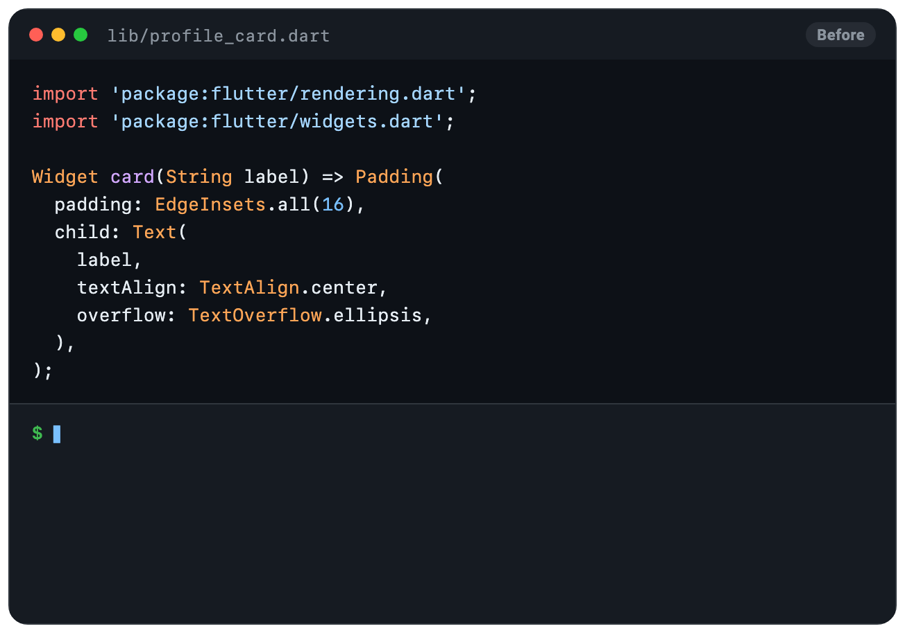

# shorthand_sanitizer

[](https://pub.dev/packages/shorthand_sanitizer)
[](https://pub.dev/packages/shorthand_sanitizer/score)
[](https://github.com/esenmx/shorthand_sanitizer/actions/workflows/ci.yaml)
[](LICENSE)

`shorthand` rewrites `Type.member` to Dart's
[dot shorthand](https://dart.dev/language/dot-shorthands) `.member` across a
whole Dart or Flutter project, then removes imports left unused. Every rewrite
is verified by the Dart analyzer and kept only when it changes nothing.



## Quick start

```bash
dart install shorthand_sanitizer
shorthand && dart format .
```

Needs Dart **3.13+** and rewrites packages targeting language version **3.10+**.
Alternative install: `dart pub global activate shorthand_sanitizer`.

<!-- no-compile -->

```dart
// Before
return Padding(
  padding: EdgeInsets.all(16),
  child: Text(
    label,
    textAlign: TextAlign.center,
    overflow: TextOverflow.ellipsis,
  ),
);

// After `shorthand && dart format .`
return Padding(
  padding: .all(16),
  child: Text(label, textAlign: .center, overflow: .ellipsis),
);
```

## Common commands

```bash
shorthand                              # rewrite default roots in place
shorthand lib test -n                  # preview (--dry-run)
shorthand --changed                    # only uncommitted git files
shorthand lib/page.dart -n --explain   # why sites stayed prefixed
shorthand -n --set-exit-if-changed     # CI gate (1=would convert, 65=skipped)
```

## Guides

- [CLI reference](doc/cli-reference.md) — `PATH` setup, every option (`--skip`,
  `--exclude`, `--since`, `--allow-errors`, `--include-generated`,
  `--no-analyzer-excludes`), exit codes, and `--format=json` schema.
- [How it works](doc/how-it-works.md) — analyzer verification, what converts vs
  what stays prefixed, generated-file detection, atomic writes and crash
  recovery, and disk cache.

## Agent skill

This package ships an agent skill in `skills/shorthand-sanitizer-usage/`.
Install it into your project's agent config with:

```sh
dart run skills@ get --package shorthand_sanitizer --agent claude --all
```

## Contributing

See [CONTRIBUTING.md](CONTRIBUTING.md).

## License

MIT — see [LICENSE](LICENSE).
